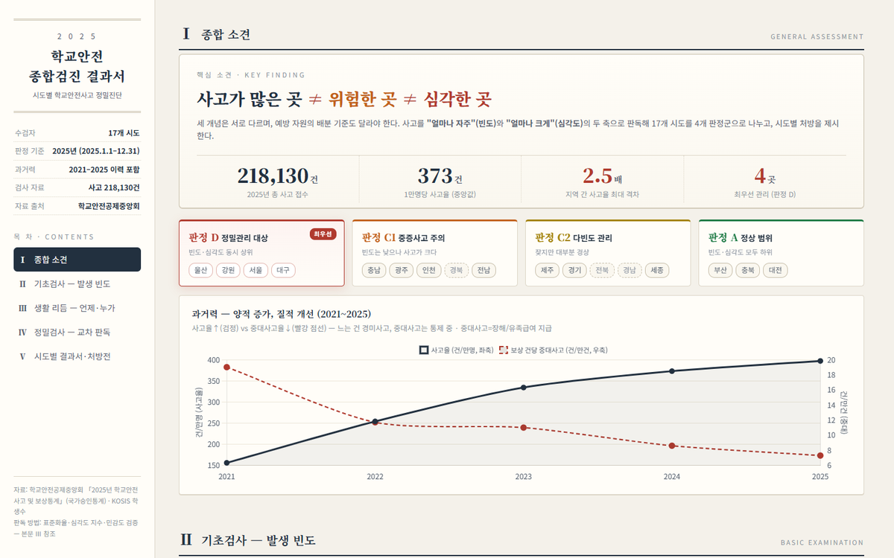

# 학교안전 종합검진 결과서 · 2026 학교안전사고 데이터 분석·활용 경진대회

> 학교안전사고를 빈도와 심각도 두 축으로 나눠, 17개 시도에 예방 자원을 어디부터 투입할지 판정한 분석
> 개인 참가 (보고서 부문) · 2026.07

**핵심 결과**: 사고가 많은 지역과 크게 다치는 지역이 다르다는 점을 확인하고, 17개 시도를 4개 판정군으로 분류. 판정 기준을 바꿔도 14개 시도는 판정 유지

---

## 1. 문제

학교안전사고 접수 건수는 매년 늘고 있지만, 건수만 보면 학생이 가장 많은 경기가 1위가 됩니다.
또 사고가 자주 나는 지역과 크게 다치는 지역은 같지 않습니다. 기존 분석은 대부분 건수로 지역을 비교하는 데 머물러, **한정된 예방 자원을 어디에 먼저 투입할지**에는 답하지 못했습니다.

## 2. 데이터

| 데이터 | 출처 | 범위 |
|---|---|---|
| 학교안전사고 접수·보상 데이터 | 학교안전공제중앙회 (대회 제공) | 2021 ~ 2025 |
| 학교안전사고 및 보상통계 | 학교안전공제중앙회 (국가승인통계) | 2021 ~ 2025 |
| 학생 수 | KOSIS | 시도·학교급별 |

- 대회 제공 원자료는 외부 공개와 생성형 AI 입력이 금지되어 있어 이 저장소에 포함하지 않았습니다.

## 3. 접근

- **빈도**: 사고 건수를 학생 수로 나눈 학생 1만 명당 사고율
- **심각도**: 평균 보상금, 중대사고율, 고액 보상 비율을 z점수로 표준화해 동일 가중으로 합친 지수
- **판정**: 두 축의 중앙값을 기준으로 4개 판정군 (최우선 개입 / 중대사고 예방 / 다빈도 관리 / 정상 범위). 이상치(제주)의 영향을 줄이려고 평균 대신 중앙값 사용
- **강건성 검증**: 가중치 조합 전수, 주성분분석 가중치, 학교급 구성을 보정한 간접표준화(SIR), 평균 보상금을 중앙값·절사평균으로 대체
- **결과 도구**: 시도별 판정과 처방을 담은 "종합검진 결과서" 대시보드

## 4. 내 역할

혼자 진행한 프로젝트로, 분석 설계부터 보고서·대시보드까지 맡았습니다.

- 빈도 × 심각도 이원 판정 체계 설계
- 판정 강건성 검증 (가중치 66조합, PCA, SIR)
- 학년·시간·사고 유형 등 교차 분석
- 결과를 시도별 검진 결과서 형태의 대시보드로 구현

생성형 AI를 분석 보조로 활용했으며, 대회 원자료는 AI에 입력하지 않고 로컬에서만 처리했습니다.

## 5. 결과

| 항목 | 결과 |
|---|---|
| 2025년 사고 접수 | 218,130건, 학생 1만 명당 사고율 중앙값 373건 |
| 지역 간 사고율 격차 | 최대 2.5배 |
| 강건성 | 가중치 66조합 중 17개 시도 중 14개 판정 유지, PCA 가중치 순위 상관 ρ≈0.998, SIR 순위 상관 ρ≈0.990 |
| 학년 | 사고 건수는 중1이 고3의 약 2.5배, 건당 평균 보상금은 고3이 중1의 약 2.6배 (같은 구기 활동) |
| 추이 | 2021 ~ 2025 사고율은 늘었지만 건당 중대사고 비율은 줄어듦 |

## 6. 한계

- 사고 '발생'이 아니라 공제 '접수' 데이터라 신고 성향이 함께 반영됩니다.
- 사고 자료와 보상 자료는 식별 체계가 달라 결합할 수 없어, 집계 단위에서 나란히 분석했습니다. 심각도는 실제 심각도의 대리지표입니다.
- 사고율 분모인 학생 수는 활동 시간 차이를 반영하지 못하는 근사입니다.

## 7. 참고

- 보고서: 「학교안전 종합검진 결과서」 (10쪽, 한글)
